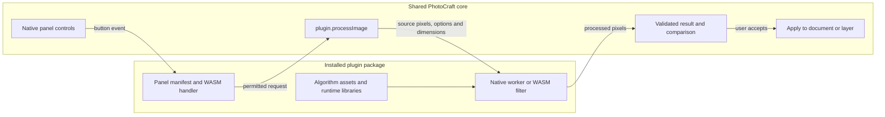

# Image processing and preview lifecycle

PhotoCraft exposes one package-owned image command: `plugin.processImage`. It supports native
workers and packaged WASM filters without an algorithm-specific command in the editor. Start
with the [independent image-processing guide](plugin-image-processing.md) for the request,
pixel formats, limits and complete native protocol, and the [package reference](plugin-native-packages.md)
for installation and dependency ownership. This page describes the shared result lifecycle.

## Responsibility boundary

| PhotoCraft host | Installed plugin |
|---|---|
| Menu, manager, generated panel and WASM execution | Panel manifest, controls and button handler |
| Snapshot, source color conversion and expected dimensions | Algorithm, option validation and model choices |
| Installation ownership, grants and structural package checks | Worker, inference libraries, models and redistributable dependencies |
| Progress, cancellation, output validation and comparison | Actual processing, progress messages and cooperative cancellation |
| Apply/Discard, document creation, layer/history handling | No direct editing of the source document from native code |

The core has no model allowlist, plugin-specific executable name or AI processing adapter.
The earlier typed AI service commands and version-1 package format were removed. Rebuild old
packages for the generic interface and replace them through Manage Plugins under the same id.
Panels use the current PhotoCraft Plugin API (internal discriminator `2`); obsolete version-1
panels must be rebuilt. Standalone filter ABI 1 remains supported and is a separate contract.

Panel logic and packaged WASM filters use bounded interpreters. Native workers run as hidden
OS processes launched by the shared bridge; their UI stays in PhotoCraft. The native worker
is supplied by the plugin package and retains the user's OS permissions.
Native workers resolve their packaged assets; sandboxed filters use embedded data and supplied
parameters rather than reading arbitrary package files.

## Generate and compare

A panel returns one `plugin.processImage` command with plugin-owned `options`, optional exact
output `width`/`height` and `preview: true` (the default). Ownership is implicit in panel actions;
trusted direct callers additionally supply the installed panel `id`. The command grant gives
the selected backend the visible composite; `documentRead` separately controls panel metadata.

The source is locked while its job runs. The plugin reports progress and honors cancellation.
Failure, cancellation or stale source data cannot admit a result or commit proposed guest state.
A successful preview stages one immutable result and returns a session-specific `preview` token.
It does not edit the source or commit guest state. The comparison UI supplies a draggable
Original/Processed divider and Fit/100% inspection. Settings changes invalidate the displayed
result until a fresh preview is generated.

## Apply and Discard

Apply opens a new unsaved result tab by default. A same-size result can instead become a new
top raster layer in an 8/16-bit RGB or grayscale source. The host converts that layer to the
source profile/depth using normal color settings. Existing layers remain beneath it but are
hidden in the same undo step, preserving the preview's transparency. Undo restores their prior
visibility; Redo reapplies the result. Enlargements require a new tab with matching dimensions.
New tabs use the normal Color Settings policy and retain source DPI.

Trusted UI/engine callers use `image.pluginPreview.apply {"preview":1,"target":"document"}`
or `target: "layer"`. Omitted target defaults to `document`. Apply consumes the token and commits
the successful action's guest state. `image.pluginPreview.discard {"preview":1}` consumes it
without editing or committing guest state. These commands are not panel grants; the plugin
needs only `plugin.processImage` for the host-owned workflow. Tokens are identifiers, not paths.

Apply checks source identity/revision and installation/enabled identity again. Source closure,
source edits, disable/re-enable, replacement/removal, reload, a conflicting operation or a
consumed token prevents stale application. Closing a comparison cancels/discards its result.
Comparisons are session-only, and at most one completed comparison is retained. Immediate
`preview: false` results use the same revocable ownership checks before opening a new tab.

Rust integrations can inspect `Session::plugin_preview(id)` or `plugin_preview_for(plugin_id)`
and validate the record before displaying Apply. The host validates again during application;
WASM panel code never receives the host's document references or preview pixels.

## Limits and trust

The generic boundary receives flattened RGBA8 sRGB and admits only bounded RGB/RGBA8 PNGs at
the requested dimensions. It currently accepts 8/16-bit RGB/grayscale sources; other modes and
HDR/32-bit sources require conversion of a copy. Native processing uses the full visible image;
packaged filters additionally honor selection coverage. Workers enforce their own stricter
algorithm, model and memory requirements. See [processing limits](plugin-image-processing.md#pixels-dimensions-and-results).

Native code has the user's OS permissions. Installation validates structure and ownership,
not algorithm quality, native dependencies or publisher trust. The shared transport supervises
the direct worker; a worker owns cleanup of its child engines. See [safety and recovery](plugin-safety.md)
and [native transport](plugin-native-packages.md#native-worker-transport-boundary).
