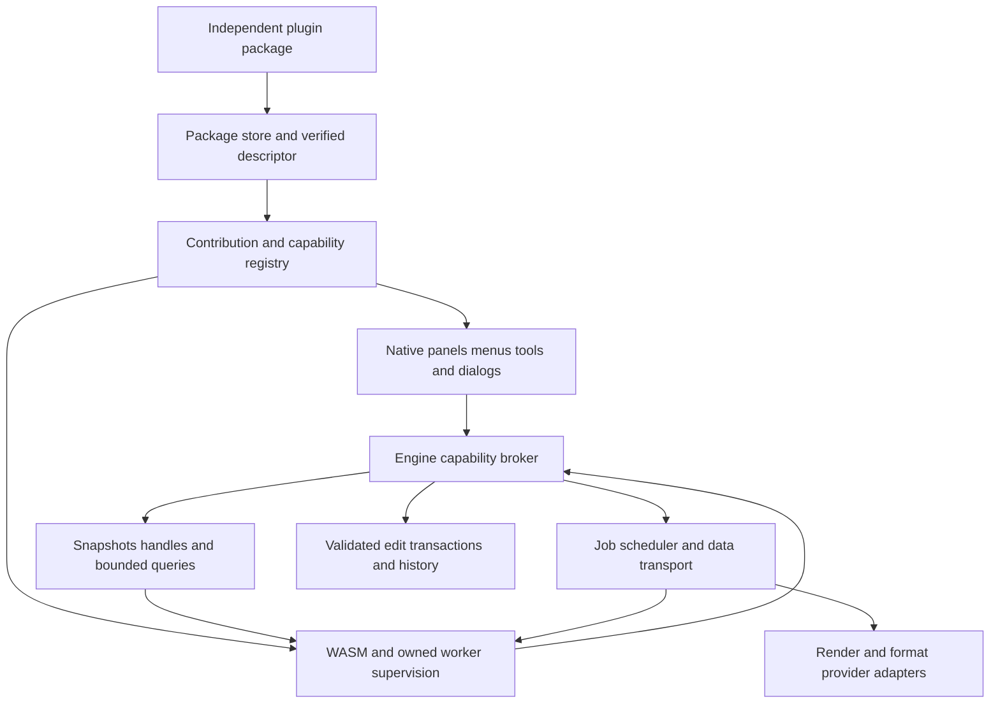

# PhotoCraft Universal Plugin Platform Plan

**Status:** P01–P05 and the current-contract API/SDK implementation are complete. Phase 2 has begun with cooperative store locks and native result admission checks; its remaining lifecycle work is proposed.

**Date:** 2026-10-16
**Scope:** Evolve the installed plugin system into a broad editor extension platform while preserving independent plugin projects, packages, releases and runtime dependencies.

PhotoCraft should expose stable, versioned capabilities for extending its editor. Each plugin should own its feature implementation and communicate through those public capabilities. The editor should never need an adapter, model list, executable name or special case for an individual plugin.

Keep the current architecture: Rust, native egui, a command-driven engine, sandboxed WASM and explicitly trusted native workers. Extend its contracts in stages rather than replace the working system. Universal means supporting the extension categories defined below through reusable APIs. It does not mean unrestricted access to editor internals or a guarantee that future capabilities will never require host development. Future-proofing means compatibility rules, explicit evolution mechanisms and tests that enforce them.

## 1. Standalone requirements

These requirements are release gates for every plugin category, including plugins maintained alongside PhotoCraft.

| Requirement | Enforcement |
|---|---|
| Independent source | A plugin has its own project root, dependency locks, tests, build scripts, notices and release version. |
| Independent build | Build an exported plugin in a clean temporary checkout with the editor repository, sibling plugins and former companion absent. A published SDK or packaged developer tool may be a normal development dependency. |
| Independent installed payload | Include the plugin's non-system runtime dependencies. Users do not install a shared Python, inference engine, companion app or another plugin. OS facilities and declared hardware drivers remain platform prerequisites. |
| Independent updates | Replacing, disabling, repairing or removing one plugin does not change another plugin's code, state or ability to run. |
| Independent dependencies | Required plugin-to-plugin dependencies are prohibited. Shared libraries are privately bundled. Optional interoperability must degrade cleanly when the other integration is absent. |
| Independent assets | Model catalogs, algorithms, asset validation and optional asset selection belong to the plugin. The host may provide generic storage/download services, but contains no model-specific knowledge. |
| Independent storage | Settings, private data, caches, secrets references and migrations are scoped by plugin identity and installation generation. No writable shared runtime directory. |
| Explicit external requirements | A cloud connector can require the user's selected service and account. Its package remains independent, but its feature must be labeled as requiring that service rather than described as offline. |
| No private host linkage | Published plugins use serialized contracts and released SDK types. They do not link to engine/UI internals, depend on host checkout paths or exchange Rust object layouts. |

The SDK is a development dependency, not a separately installed runtime service. Host-managed deduplication may eventually reuse identical immutable bytes internally, but must be invisible to plugins and safe when either plugin is removed. It is not required for the first release.

## 2. Existing contracts to preserve

The implementation currently provides package format 2, panel API 1, standalone filter ABI 1 and native image/task protocol 1. These are separate version dimensions. Package-v1 AI services have already been retired; this plan protects the currently supported contracts and retains existing repair guidance for those retired installations.

| Existing area | Preserve |
|---|---|
| `crates/plugins/src/extension.rs` and `extension/runtime.rs` | Embedded manifests, import-free WASM, bounded execution and JSON event/response handling. |
| `crates/engine/src/extension_cmds.rs` | Installation ownership, command grants, enable state and session state semantics. |
| `crates/engine/src/extension_package.rs` | Safe archive paths, hashes, installation generations, staged publication, repair and ownership checks. |
| `crates/engine/src/plugin_image_cmds.rs` | Owning-installation processor resolution and generic image processing. |
| `crates/engine/src/plugin_task_cmds.rs` | Owned native maintenance jobs without an open document. |
| `crates/engine/src/plugin_runtime.rs` | Legacy `--job`/`--task` workers, progress, cancellation and output validation. |
| `crates/engine/src/plugin_preview.rs` | Source/revision validation, result revocation and safe Apply/Discard. |
| `crates/ui-egui/src/extension_ui.rs` and submodules | Native panels, manager, review, comparison and shared controls. |

Keep existing supported plugins and neutral starters working as delivered. Do not silently reinterpret old messages, increase their permissions or change the legacy 8-bit sRGB processing boundary. Existing panel command lists remain sequential; a new atomic editing API must have distinct semantics.

## 3. Supported extension categories

The platform is ready for a broad ecosystem when all these categories can be implemented in independent projects without plugin-specific changes to PhotoCraft.

| Category | Public capability to add | Acceptance plugin |
|---|---|---|
| Commands and workflows | Namespaced commands, menus, shortcuts, typed parameters and enable predicates | Layer Organizer with one atomic editing action |
| Panels and inspectors | Native declarative views, dynamic data, tables, text inputs and docking | Document Inspector with live selection/layer information |
| Pixel processing | High-precision regions/tiles, profiles, channels, masks and explicit output contracts | Channel Mixer with 8/16/32f and CMYK cases |
| Non-destructive effects | Versioned effect recipes, tile evaluation, cache invalidation and saved state | Live Grain with deterministic rendering and missing-plugin fallback |
| Generators | Empty-canvas/layer generation, bounds, seed and parameters | Procedural Texture Generator without an input image |
| Canvas tools and brushes | Input events, cursors, overlays and stroke transactions | Measurement Tool and pressure-sensitive Pattern Brush |
| Importers and exporters | Format descriptors, bounded probes, streaming file handles and document interchange | Test Pattern Format reader/writer |
| Assets and presets | Paginated catalogs, thumbnails, import, provenance and cache APIs | Local Pattern Library |
| Integrations and background work | Owned jobs, events, brokered files/network/auth and resumable managed state | Opt-in remote asset connector against a local test service |
| Appearance and workspace contributions | Validated theme tokens, icons, panel placement and settings | Accessible Contrast Theme and inspector workspace preset |

These are capability families rather than separate installation systems. A single package can contribute several categories. Photoshop UXP/CEP/.8BF and OpenFX compatibility are separate adapter projects, not implied by support for equivalent plugin categories.

## 4. Target architecture

The broker is the host boundary that checks the invoking plugin, permissions, automation authority, document revision and resource budget for every request. Contributions declare where a plugin appears; capabilities determine what it may do. A contribution declaration never grants a capability by itself.

### 4.1 Preserve dependency layers

Add a publishable `photocraft-plugin-api` crate at L0 containing protocol data, IDs, errors and validation primitives only. Add a guest `photocraft-plugin-sdk` with no engine, UI or host checkout dependency. Register new workspace crates in `xtask/src/layers.rs`; publish SDK releases so plugins need no editor source.

Keep WASM execution and package-independent runtime utilities at L4 in `crates/plugins`. Keep installation orchestration, capability checks, document mutations and scheduling at L5 in `crates/engine`. Keep all egui rendering at L6.

L1 document structures contain serializable external-effect references, not runtime objects. L3 composition and format code may expose neutral provider interfaces or consume precomputed surfaces; they must never import the L4 plugin runtime or L5 engine. L5 adapters implement those interfaces and arrange evaluation outside rendering locks. I/O extensions use the same dependency-injection rule. No engine command can be re-entered from a compositor callback.

### 4.2 Add a generic contribution registry

Introduce `PluginContributions` containing commands, menu placements, panels, tools, effects, generators, file formats, assets and appearance contributions. IDs are owned namespaces such as `org.example.measure.distance`; collisions and attempts to replace built-in commands are rejected.

Enable predicates use a small validated context-expression language with bounded evaluation. No guest code runs while constructing menus or checking every frame whether a menu item is enabled. Dynamic command specs are owned descriptors; the existing static `CommandSpec` registry remains intact and receives a generic plugin dispatcher.

Registered commands appear in applicable menus, the command palette, shortcuts, CLI/control discovery and MCP through the existing command system. Add session-aware resolution that checks built-ins and contributed descriptors; do not leave dynamic commands invisible to existing static lookup callers. Every route retains the same authority checks. Removing a contribution cleans up runtime registrations while retaining recoverable user settings.

### 4.3 Add a capability registry

Represent capabilities as separately versioned families, for example:

| Proposed capability | Authority |
|---|---|
| `host.document.read@1` | Paged snapshots of permitted document structure |
| `host.document.edit@1` | Validated edits to the selected document |
| `host.image.tiles@1` | Declared pixel formats, regions, channels and masks |
| `host.events@1` | Explicit subscriptions with bounded delivery |
| `host.ui.views@1` | Native declarative views and UI events |
| `host.tools@1` | Tool input and overlay output |
| `host.formats@1` | Import/export registration and bounded streams |
| `host.storage@1` | Plugin-private managed state and assets |
| `host.files.selected@1` | Handles to user-selected files or folders |
| `host.network.fetch@1` | Brokered requests to declared origins |
| `host.auth@1` | Account flows and opaque credential references |
| `host.jobs@1` | Owned background work, progress and cancellation |

A request's identity comes from the host invocation context, never a guest-supplied plugin ID. Handles are scoped by owner, generation, document/session and permissions; guessable IDs alone grant nothing. Enforce bounds, expiry, revocation and cleanup. Preserve the existing grant allowlist through a legacy adapter rather than replace it with wildcard command access.

## 5. Compatibility and protocol design

### 5.1 Support policy

The current 0.1 foundation preview implements the evolution rules in the [SDK guide](plugin-sdk.md#compatibility-and-evolution-policy).
The calendar support commitment below is a proposed stable-release policy, not an active
24-month guarantee for the preview. SDK sources are distributed through the developer tool;
public registry publication and ecosystem-wide release certification have not been performed.

Adopt the following policy before inviting external developers:

1. Freeze the behavior of current supported v1 interfaces and package format 2 in immutable compatibility fixtures.
2. Introduce panel API 2, worker protocol 2 and a richer package format 3 alongside the legacy adapters. Standalone filter ABI 1 continues to work; add a new filter ABI only when its transport requires one.
3. Version capability families independently. Compatible additions stay within a major version; a breaking change gets a new major and an adapter when practical.
4. Support the previous stable host API major for at least 24 months after its successor becomes generally available. Publish a removal date, migration tooling and fixture results before retirement. Security exceptions require a specific advisory and recovery path.
5. Require host API ranges and required capability versions; allow explicitly optional capabilities with declared fallbacks. Discovery and installation return structured incompatibility reasons.
6. Keep plugin release version, package format, host API, panel ABI, worker transport and saved-data schema separate.

Strict validation remains valuable. New protocols provide a bounded namespaced `extensions` area and explicit optional-feature negotiation; do not make old parsers permissive or silently ignore required behavior. Unknown required capabilities fail before activation.

### 5.2 One authoring schema

The SDK takes one source manifest and generates package metadata, the embedded guest manifest, bindings, documentation and fixtures. For package format 3, `package.json` becomes the installation descriptor with identity, compatibility, contributions, capability requests, activation rules, target-specific payloads and transport declarations. The embedded API-2 manifest must match its generated identity/contract digest. A v2 package retains its existing descriptor and embedded-manifest rules.

Validate contribution IDs, UI trees, platform support, limits and permission changes without executing the plugin during normal discovery. Installation may run the existing bounded guest validation. Persist a host-created descriptor for lazy startup; never trust an unverified loose sidecar as installed authority.

Before freezing package format 3, write its complete JSON Schema and malformed-input corpus. Larger asset packages need streaming extraction, explicit disk budgets and tested ZIP64 support if adopted; do not merely remove the current archive limits or load entire large archives into memory. Existing v2 archive limits remain unchanged.

### 5.3 API 2 control messages

Keep the four core WASM export shapes where practical and select behavior using `pce_api_version`. API 1 remains fresh-instance, import-free and unchanged. API 2 receives a versioned event envelope and returns bounded effects with correlation IDs. Host query/job completions arrive as later response events. The SDK handles continuations; WASM does not gain ambient filesystem, network or process imports.

Worker protocol 2 adds a fixed host-launched `--serve` mode using bounded, length-prefixed JSON control messages over stdio. Define the exact frame format, handshake, correlation IDs, errors, cancellation, deadlines, EOF and diagnostics in a protocol document before coding. Stdout becomes a protocol channel only for workers declaring protocol 2; legacy stdout behavior stays unchanged. Bulk pixels never travel as JSON or base64.

A worker handshake confirms the descriptor's declared protocol and selected optional features. A mismatch fails rather than falling back to a different trust mode. Native workers may make broker requests, but document access and mutation still execute at the engine gate, never from a worker thread holding editor locks.

## 6. Editor APIs

### 6.1 Documents and atomic editing

Expose paginated read-only snapshots of layers, groups, masks, channels, paths, metadata and selections. Use stable IDs and typed resource handles rather than exposing internal `Document`, `Layer` or `Surface` layouts. Queries specify fields, maximum result bytes and continuation tokens.

Add a single-document edit transaction:

1. Begin against a document revision and receive a scoped transaction handle.
2. Accumulate validated typed operations and result blobs without mutating the document.
3. At commit, recheck permissions, installation generation, source revision, locks and operation preconditions.
4. Apply all operations through one `Session::edit`/history transaction, or apply none.
5. Deliver change events after commit and after locks have been released.

Do not implement atomicity by executing arbitrary existing commands and trying to Undo them afterward. File writes, network requests, native side effects, Undo and Redo are excluded from an edit batch. Multi-document atomicity is a later capability, not an implicit guarantee. Legacy sequential command actions retain their existing behavior.

### 6.2 Events and activation

Activate on a contributed command, panel opening, tool selection, matching file format, effect evaluation or an explicitly permitted subscription. Inactive plugins contribute metadata without starting WASM handlers or native processes. General startup execution is opt-in and separately visible to users.

Provide document/layer/selection changes, panel field changes, job completions and storage changes. Every event carries sequence, revision, origin and subscription IDs. Coalesce high-frequency updates, bound queues, reject recursive event storms and cancel subscriptions on disable/removal. Plugins must recover by requesting a fresh snapshot after a documented overflow event. Callbacks cannot block the UI thread.

### 6.3 Native views and appearance

Extend the declarative UI schema with text/password inputs, color controls, grouped layouts, tabs, lists, tables, trees, file-picker intents, images/thumbnails, accessible labels and dynamic updates. File inputs return brokered handles; they do not silently grant filesystem access. State is split into transient view state, durable plugin settings and document-owned data.

Render everything through egui and PhotoCraft theme tokens at L6. Add docking through the existing panel infrastructure. Bound tree depth, row counts and update rate; virtualize large lists. Validate theme contributions and icons against native accessibility and sizing rules. Do not add HTML, JavaScript, Tauri, Electron or a webview.

### 6.4 High-precision image transport

Retain legacy PNG jobs as a compatibility path. Add an image descriptor with sample type, color model, channel roles, alpha association, ICC/profile identity, dimensions, origin, row stride, region and read/write policy. Support 8/16-bit and float32 first; negotiate additional formats explicitly. Never imply that conversion to float restores precision already lost by a legacy processor.

Provide composite, layer, mask, selection and channel sources through separate grants. Support requested regions, overlap/halo, output bounds, cancellation and bounded tile streaming. Some algorithms need whole-image analysis or multiple passes; define an analysis pass and ordered stream option rather than pretend every algorithm is a stateless tile filter.

Start with portable bounded files/streams and host-owned data handles. Benchmark memory-mapped/shared-memory transport as an optimization; accept it only with checked offsets, lifetime rules and cross-platform tests. GPU contexts and raw device pointers are not part of the initial contract. Existing GPU-based native workers continue privately under their declared trust profile.

### 6.5 Effects and saved documents

Use generic effect/generator references containing plugin ID, contribution ID, recipe schema version, parameters, deterministic seed, asset digests and an optional cached result. Keep executable code out of `.pcraft` files. Preserve unknown plugin payloads with bounded, namespaced envelopes during save and reopen.

Render through L5 provider adapters and immutable caches keyed by recipe, inputs, profile and output format. The compositor consumes validated results and never calls an engine command recursively. Missing or incompatible plugins show a clear placeholder or available cached pixels while preserving editable recipe data. Opening a document must not install code, download assets or grant capabilities.

Do not silently migrate a saved recipe to a different algorithm version. A plugin supplies an explicit migration or retains an old evaluator; otherwise preserve the recipe and offer a deliberate conversion/bake workflow. Save-format mapping, cached fallbacks, Undo/Redo and missing-plugin round trips are release gates.

### 6.6 Tools and brushes

Add engine-owned tool sessions receiving normalized pointer, pressure, tilt, keyboard and modifier events. Output is bounded overlay primitives, cursor descriptions, previews or typed edit intents. A stroke commits as one transaction; cancellation/focus loss/document close aborts uncommitted work.

Use the existing native input and brush infrastructure. Add one generic contributed-tool identity and provider adapter; adding a second plugin tool must not require another built-in enum variant or routing branch. Keep legacy WASM instances fresh; API-2 interactive sessions may use bounded persistent instances with per-event fuel, explicit reset and teardown. Heavy native work runs asynchronously. No arbitrary plugin callback executes in the UI drawing path, and no synchronous native round trip is required for every pointer sample. A slow provider is paused or loses interactive admission before it degrades the entire editor.

### 6.7 Formats, assets and integrations

Format providers declare extensions, MIME types, bounded signature probes, supported depths/modes/layers/profiles, import/export options and priority. Resolve conflicts visibly. Decode into a versioned document interchange description plus pixel handles; validate before opening a document. Export to a host-controlled temporary stream and publish the destination atomically on success. Malformed files execute in the provider's selected containment profile.

Asset providers expose paginated catalogs, thumbnails, licenses, import intents and change events. Generic host storage can manage immutable blobs without understanding the plugin's model or asset catalog. External-service connectors use brokered network origins, account flows and opaque secret references. Native tasks remain available for plugin-owned diagnostics and maintenance. No network or message-sending authority is implied by installation or an asset contribution.

## 7. Runtime scale and trust

### 7.1 Lifecycle and scheduling

Introduce a runtime manager with discovered, compatible, disabled, idle, activating, active, stopping and failed states. Use lazy activation and per-plugin queues. Keep interactive previews ahead of background indexing/batch work, apply fair scheduling across plugins, and account for aggregate CPU, memory, GPU, temporary disk and managed cache use.

Worker protocol 2 can retain a model in a private long-lived process, with explicit idle eviction and reset. No process/runtime pool is shared between unrelated plugin identities. Per-job isolation remains available. Legacy worker launch behavior does not change.

Replace the single session preview slot with previews keyed by plugin, document and invocation. Preserve source-revision checks and revoked-generation checks independently for every result. Bound retained comparisons by memory, not just item count. A plugin must not evict another plugin's unapplied result without a visible policy and user action.

Define initial queue/message limits in the protocol, then tune using Phase 0 measurements. Limits are finite, reported through capabilities and distinguish control metadata from bulk data. Raising the current installed-plugin cap is a result of scale testing, not the scaling strategy itself.

### 7.2 Store consistency and storage

Keep immutable installation generations and publish the active record last. Add an inter-process store lock and inter-process generation leases so two PhotoCraft instances cannot replace or collect files another instance is using. Process-local `Arc` leases alone are insufficient for this case.

Separate package code, immutable assets, settings, durable data, caches and secrets references. Track their sizes and quotas separately. Updates stage managed-data migration against a backup and switch generations only after successful validation. Rollback covers host-managed state; arbitrary side effects of trusted native code cannot be rolled back by PhotoCraft.

Startup uses the validated descriptor index instead of rereading every model payload. Verify executable code and dependency closure before activation. Verify assets before use according to the integrity profile, with tests for changes between validation and access. File timestamps alone are not proof of integrity. Do not promise tamper-proof native execution against another process with the same user's unrestricted privileges.

Support interrupted installation/migration recovery, read-only stores, full disks, long paths, cache cleanup and explicit uninstall choices. Preserve existing plugin-owned external caches, including assets downloaded by a plugin, unless a specific authorized migration/removal operation manages them.

### 7.3 Honest execution profiles

| Profile | Guarantee and policy |
|---|---|
| Sandboxed WASM | Bounded computation, no ambient OS access; brokered capabilities only. Default for portable logic and tools that fit this profile. |
| Restricted native worker | Available only where an implemented and verified OS process/filesystem/network containment profile enforces the declared grants. No silent fallback to unrestricted execution. |
| Trusted native worker | Preserves current compatibility and explicit native-code consent. Runs with user OS privileges; narrow broker grants do not confine its independent OS access. |

Implement supervisors using safe Rust APIs or audited external components that respect the repository's no-unsafe rule. If containment cannot meet the stated profile on a platform, advertise it as unavailable and retain the explicit trusted-native option. Test descendant termination and resource containment on actual target operating systems rather than equate a separate process with a sandbox.

Disabling a plugin immediately revokes host requests, subscriptions and result commits. Native stop/cleanup proceeds under a bounded deadline. Diagnose crashes by plugin/generation; quarantine repeated activation failures with a visible recovery action. Preserve `--disable-plugins` and all restricted-automation checks, including calls nested inside plugin callbacks.

### 7.4 Distribution and publisher trust

Add publisher keys, signed package indexes, verified update metadata, explicit permission diffs, rollback and revocation. Keep local unsigned development packages possible through an explicit trust path. A signature identifies the signing key and protected bytes; it is not proof that a plugin is safe or its licenses are sufficient.

Sign a canonical integrity index covering package metadata and every executable, library, asset and other payload member; exclude only the integrity/signature envelope itself. Reject unlisted files. Test key rotation, metadata tampering, permission expansion, downgrade and interrupted update behavior. Updates follow the user's chosen policy; never silently expand permissions.

A directory/marketplace lists compatible targets, declared capabilities, execution profile, dependencies bundled, storage needs, licensing and conformance results. Install/update always use the same package store APIs. Hosting infrastructure is optional for manual/offline installation and is not part of a plugin's runtime dependency chain.

## 8. Implementation phases

Effort ranges below are initial engineering estimates for completed code, tests, documentation and integration, not elapsed calendar commitments. They total **43–72 engineer-weeks**. Re-estimate after the baseline and first vertical slice. Team size, operating-system validation and unresolved build/toolchain work affect elapsed time.

| Phase | Work packages and concrete output | Primary source areas | Dependencies | Effort |
|---|---|---|---|---|
| 0 Baseline and compatibility | Archive neutral protocol artifacts and hashes; record behavior; establish performance harness and independent-build checks; separate legacy contracts | Existing engine/plugin/UI tests, `docs/plugin-testing.md`, `perf/`, `xtask` | None | 1–2 weeks |
| 1 Contracts and SDK | Publish API crate/schema; capability and contribution descriptors; API-2 handshake/envelopes; legacy adapters; starter CLI/specification | New `crates/plugin-api`, guest SDK, `crates/plugins`, engine registry, `xtask/src/layers.rs` | Phase 0 | 3–5 weeks |
| 2 Lifecycle and store | Lazy descriptors, supervisor, worker protocol 2, per-plugin scheduling, quotas, cross-process locks/leases and migration/rollback plumbing | `extension_package.rs`, proposed `engine/src/plugin_host/`, `jobs.rs`, startup | Phase 1 | 5–8 weeks |
| 3 Commands documents events and views | Dynamic command registration; paged reads; atomic edit batches; event delivery; native view schema/docking; durable settings | `commands.rs`, proposed `plugin_host/{broker,contributions,documents,events}.rs`, `extension_ui/`, `state.rs`, automation | Phases 1–2 | 6–9 weeks |
| 4 Image transport | Profile/depth-aware descriptors, regions, masks, generators' basic output, streaming blobs, cancellation and legacy PNG adapter | `plugin_image_cmds.rs`, `plugin_runtime.rs`, `plugins/`, raster/CMS adapters | Phases 1–2; integrate with Phase 3 | 5–9 weeks |
| 5 Live effects and document persistence | Recipe references, render scheduling/cache, unknown data preservation, migrations, missing-plugin behavior and deterministic generators | `doc`, `compose`, `format`, `engine` smart/filter paths | Phases 3–4 | 6–10 weeks |
| 6 Tools formats assets and appearance | Interactive tool/brush sessions; overlays; generic format providers; asset catalogs; theme/workspace contributions; neutral acceptance plugins | `engine`, `paint`, `io`, `ui-egui/{canvas,tool_*,dock,theme}.rs`, format adapters | Phases 3–5; format/asset work can begin earlier | 8–14 weeks |
| 7 Trust and distribution | Verified native containment profiles; signing/update policy; permission diffs; rollback/revocation; offline developer tooling | Supervisor, package store, manager, SDK tooling, distribution service if selected | Phase 2; begins before broad beta | 4–7 weeks |
| 8 Scale and stable release | Real target-OS matrix, adversarial/fuzz/soak workloads, API compatibility certification and developer pilot fixes | CI, `xtask`, testkit, perf, docs and every capability adapter | Phases 3–7 | 5–8 weeks |

Security, compatibility and cross-platform tests begin with the first phase that changes the relevant code; Phase 8 is their combined release qualification, not their starting point. Distribution service operations and ongoing SDK maintenance are additional continuing work.

### Phase acceptance criteria

| Phase | Gate required before proceeding or advertising the capability |
|---|---|
| 0 | Exact existing packages install, restart, process, cancel and Apply through the public APIs. Record source preservation, enabled state, known limits and installed dependency closure. Baselines run on a reproducible release build; resolve the recorded GNU `nanosleep64` link blocker or establish an explicitly supported alternative build before publishing release-performance claims. |
| 1 | Old binaries run unchanged. Missing required capabilities fail clearly; missing optional ones take tested fallbacks. Generated schemas and bindings agree. Build a neutral plugin with editor/sibling sources absent. |
| 2 | Installing 1,000 dormant synthetic descriptors starts no workers. Two editor processes cannot delete or replace an in-use generation. Crash/full-disk/interrupted-migration tests preserve the prior working installation and managed data. |
| 3 | Layer Organizer commits one Undo step or none; Document Inspector updates without polling the UI each frame. Revoked handles, event storms and stale document revisions are rejected. Dynamic commands work through UI and authorized headless entry points. |
| 4 | Pixel/alpha/profile tests pass at 8/16/32f, grayscale/RGB/CMYK, masks, nonzero origins and region edges. Processing does not require a whole-image allocation. Unsupported formats are reported, not silently converted. Existing PNG workers remain unchanged. |
| 5 | Live Grain/Generator saves and reopens; disabling/removing the plugin preserves recipe data and cached display where available. Reinstall restores evaluation without document corruption. Render graph cycles and stale tiles fail safely. |
| 6 | Independent tool, brush, format, asset and appearance plugins register through descriptors only. They pass input/cancellation, Undo, malformed-file, accessibility, headless and standalone-build tests appropriate to their categories. |
| 7 | Tampered metadata/code, revoked keys and unauthorized permission expansion fail. Each advertised native containment profile passes OS-level descendant, filesystem and network tests. Existing trusted-native packages still require and receive the correct disclosure. |
| 8 | Compatibility fixtures, scale budgets, user recovery, all supported target-OS tests and the independent developer pilot pass. No plugin-specific host adapter is added to make an acceptance plugin pass. |

### Release milestones

- **Foundation preview after Phase 3:** compatibility, SDK, commands, document edits, events and native views. Describe only these completed capabilities as supported.
- **General editor extension beta after Phase 6 and the required Phase 7 trust gates:** demonstrate every category with independent neutral plugins. Existing AI packages remain useful regression fixtures rather than the definition of the platform.
- **Stable platform release after Phase 8:** publish the support window, API/schema versions, target matrix, compatibility results and measured budgets. Future capabilities follow the same review and conformance process.

## 9. First implementation slice

Start with the following small, ordered changes. Each is a reviewable pull request when implementation is authorized.

| Change | Exact scope | Required evidence |
|---|---|---|
| P01 Compatibility fixtures | Add immutable neutral fixtures for current panel/filter/package/native protocols. Keep independently released plugin fixtures and acceptance tests in their own repositories. Record hashes and licenses; fetch large permitted artifacts from a controlled test store rather than commit runtime/model binaries. | Exercise old bytes, not rebuilt current-source replacements; install/restart/cancel/Apply/repair all pass. |
| P02 Standalone conformance tool | Extend the independent starter checks into a developer command that checks package shape, manifests, ABI, declared targets, dependency ownership and clean exported builds. Keep Python packaging helpers supported while adding a Rust developer-tool path. | A clean exported Image Gain project builds and packages without the editor, a sibling plugin, companion or hidden PATH dependency. |
| P03 API and descriptor schema | Add `photocraft-plugin-api`, JSON schemas, typed capability IDs, structured errors and descriptor validation. Register its L0 layer. Produce the package-3/panel-2 protocol RFCs without changing accepted legacy behavior. | Schema round trips, malformed inputs, generation consistency and layer/wasm checks pass. |
| P04 Broker and legacy adapter | Introduce host-injected principals, scoped handles, capability discovery and structured incompatibility errors. Route existing plugin requests through the adapter without changing their wire format. | Cross-plugin/generation/automation authority tests and all legacy fixtures pass. |
| P05 One new vertical slice | Register a contributed Layer Organizer command and Document Inspector view; add single-document atomic edits plus the minimal layer-change event needed by those two plugins. | Both plugins are independent packages. Organizer changes several layers in one Undo step; Inspector reflects changes; injected failure commits nothing. |

P05 is the first proof that the framework serves new editor functionality beyond image-processing jobs. Do not convert all existing plugins to API 2 during this slice. Their unchanged packages prove that platform evolution does not force synchronized releases.

### First implementation slice (2026-10-15)

P01–P05 now have concrete implementations. This is an additive foundation and two working
extension categories, rather than completion of all categories in section 3.

| Change | Implementation |
|---|---|
| P01 | [Immutable compatibility corpus](../tests/plugin-compatibility/README.md), pinned compiled neutral panel/filter, golden responses and the external neutral native archive hash. Explicit native tests fail when an artifact is absent or changed. |
| P02 | [Rust conformance tool](../apps/photocraft-plugin/README.md): package/ABI/target validation, local dependency ownership, clean exported builds, deterministic packaging and hashes. Existing Python helpers remain usable. |
| P03 | Independent `photocraft-plugin-api` L0 contract crate, generated [JSON schemas](../schemas/plugins/), capability negotiation, contributions and structured errors. [Panel API 2](plugin-api-v2.md) is experimental; [package 3](plugin-package-v3.md) and worker 2 remain proposals. |
| P04 | `engine/src/plugin_host/`: host-created principals, session/installation-scoped handles, revision checks, captured/current automation policies, capability discovery and a legacy adapter preserving API-1 wire messages and sequential behavior. Startup and installation reject contributed command collisions. |
| P05 | Dynamic command discovery/menu/palette/assigned-shortcut routing, bounded layer snapshots and atomic rename/visibility batches, coalesced document invalidations and native read-only inspectors. Independently built [Layer Organizer](../examples/extensions/layer-organizer/) and [Document Inspector](../examples/extensions/document-inspector/) packages exercise the real WASM boundary. |

The first host slice supports one inspector and one matching document subscription per
plugin, four host-query rounds, eight requests per response, 128 layers per page/batch,
4096 handles per session and four simultaneous event workers across the process. Event
queues rotate fairly and idle frames do not execute guests or rescan documents. Desktop
inspector handlers run off the drawing thread; browser execution remains bounded and inline.
Discovery reports these limits. The existing installed-plugin limit remains 128.

Atomic edits are single-submit, single-document batches limited to layer names/visibility.
Observers cannot edit. Successful batches form one Undo step; failed batches retain the
document, revision, history and guest state. The sample Organizer explicitly refuses documents
larger than its first 128-layer snapshot rather than applying a partial rename. The Inspector
shows its bounded first page and the total count.

General docking/widgets, file/network services, persistent guest workers, pixel/tile APIs,
effect recipes, tools/brushes, formats, finer store scheduling, native process containment,
signing and large-ecosystem qualification still belong to later phases. These limits must
remain visible when describing current extensibility or scale readiness.

### API/SDK completion and first Phase 2 slice (2026-10-16)

The current-contract SDK work adds an independent L1 `photocraft-plugin-sdk`, typed event/reply
and document contracts, bounded guest-owned ABI buffers, and optional authoring generation.
One `authoring.json` generates the embedded descriptor, package-2 metadata and Rust bindings.
The developer tool exports API/SDK sources or a complete private SDK project from its embedded
bundle; no editor checkout, sibling plugin or shared installed runtime is required. Existing
starters and binaries keep their wire versions and need no SDK migration. Ten generated schemas
describe these contracts. See [SDK usage and evolution policy](plugin-sdk.md).

The generated guest acceptance path builds outside the editor with locked dependencies,
loads its actual release WASM, invokes a contributed command and typed layer broker, commits
an atomic edit, and verifies Undo. Temporary projects/packages are removed after the run.
SDK/API 0.1 are a source-distributed foundation preview; registry publication and full stable
ecosystem certification remain release work, not claims made by these changes.

Phase 2 starts with a cooperative OS reader/writer store lock, shared leases through native
execution and result admission, and persisted per-plugin activation epochs. Native completion
and Apply reject another current host's update/remove/disable, including disable/re-enable and
identical reinstall cycles. Separate-process tests cover contention, crash release and preservation
of active files. The lock is initially store-wide: native work temporarily blocks management
operations, while readers may run concurrently. See [store safety](plugin-safety.md#cooperative-store-locking).

Phase 2 remains incomplete. Lazy descriptors, per-generation scheduling/leases, persistent
worker protocol 2, aggregate quotas, migrations/rollback, crash quarantine and native process
containment are still proposed. The installed-plugin limit remains 128; no thousand-plugin or
cross-platform performance certification is implied.

## 10. Performance and scale qualification

Adopt the following provisional budgets on a named reference machine, release build and recorded data set. Phase 0 establishes the baseline; revise a target once with a documented reason before freezing it in CI. These are acceptance targets, not claims about current performance.

| Workload | Proposed acceptance target |
|---|---|
| Startup with 1,000 installed but inactive descriptors | Plugin discovery adds at most 250 ms p95 and 32 MiB retained metadata memory; zero guest/worker activations and zero bulk model scans. Measure framework overhead separately from total app startup. |
| Menu and command discovery | Cached contribution lookup completes within a 16 ms frame budget at p95 for the scale fixture. No filesystem scan or guest execution while drawing menus. |
| Interactive event delivery | Plugin-related main-thread work adds at most 2 ms p95 in the reference 60 Hz input workload. Slow plugin code executes off the drawing path and is bounded or suspended. |
| Repeated processing | API-2 transport overhead for the defined 24 MP lightweight filter stays within 15% of an equivalent local-buffer baseline, excluding algorithm work but including required transport/conversion. Keep legacy PNG measurements separate. |
| Cancellation | Host revocation/acknowledgement within 100 ms p95. Worker termination has a separate documented grace and profile-specific descendant guarantee; do not equate acknowledgement with completed native cleanup. |
| Resource pressure | Under concurrent plugins, admitted work stays within configured aggregate memory/disk/worker budgets; interactive work is not indefinitely starved by batch jobs. |
| Long-running use | A 24-hour mixed workload and 20,000-job fixture retain memory within 5% of the defined post-warmup idle baseline after bounded caches are drained. No leaked handles, leases, subscriptions or child processes. |

Include 1/10/100/1,000 dormant-plugin runs, 20 model-heavy packages, multiple documents/previews, repeated update/remove cycles, plugin crashes, CPU/GPU contention and low-disk conditions. Test cold and warm activation separately; a model's loading time is reported separately from descriptor discovery.

## 11. Verification and release checklist

Every capability family needs a neutral sample, schema documentation, negative cases and a compatibility fixture. Compile/run the guest artifacts in the actual host; pure handler tests are insufficient.

- Preserve old package/panel/filter/native worker artifacts and behavior across supported host releases.
- Test missing required/optional capabilities, permission changes, malformed messages, integer overflow, invalid handles, queue overflow, recursion, EOF, cancellation and plugin crashes.
- Prove cross-plugin and cross-generation isolation for jobs, assets, documents, secrets references, callbacks and preview Apply.
- Test one-step Undo/Redo, failed-transaction preservation, source changes, locks and stale results at several bit depths and profiles.
- Fuzz package readers, schemas, RPC framing, tile descriptors, effect recipes, format-provider output and saved plugin envelopes with bounded resources.
- Build exported acceptance plugins with a restricted PATH and no host/sibling checkout. Audit native dependency closure on each claimed OS/architecture.
- Verify that production host code has no acceptance-plugin-specific adapter/ID/model registry and that its dependency graph does not import acceptance-plugin implementations. Permit those names only in fixtures, documentation and intentional integration tests.
- Test Windows x64, Linux x64 and macOS ARM64 on actual runners before claiming those targets. Advertise other targets only after their own checks. Browser guests receive only capabilities available there; native code never silently falls back to browser execution.
- Run `cargo test` for touched crates, all-target Clippy, formatting, dependency layers and configured WASM checks. Run panic hunt for changed engine commands; run parity generation for commands/menu changes, and the required corpus suites for document/format/I/O/compositor work.
- Inspect native views, docking, overlays and manager states across supported themes, compact/wide windows, scaling factors and keyboard/screen-reader use. Performance and release-build gates remain separate from UI snapshots.
- Include two concurrently running hosts, interrupted install/migration, tampered files, rollback, removed plugins, unavailable services and offline activation.
- Publish a machine-readable capability/target conformance report and known limitations with each host API release. Keep plugin telemetry local by default and exclude images, credentials and private document paths from diagnostic exports.

## 12. Decisions to keep bounded

| Decision | Initial choice | Condition for reconsideration |
|---|---|---|
| Host replacement | Extend the existing host and preserve adapters. | A measured requirement cannot be met by an additional runtime adapter. |
| WIT and Component Model | Use their interface/resource concepts as design references; do not require a runtime migration in Phase 1. Generate typed Rust/schema contracts first. | A prototype demonstrates language/tooling benefits, required feature support, safety and acceptable cost on all target platforms. |
| Pixel transport | Versioned streams/files first; shared memory is optional. | Benchmarks show material benefit and lifetime/containment tests pass. |
| GPU API | Keep existing private native GPU engines; expose no raw GPU handles initially. | A dedicated compute-capability design passes portability, driver-failure and validation review. |
| Plugin dependencies | No required runtime dependencies on other plugins. | The standalone requirement changes explicitly; no dependency resolver is added speculatively. |
| Shared model/runtime services | Plugin-owned catalogs and private runtimes. | Storage-only deduplication can preserve ownership, removal safety, integrity and offline operation without making plugins depend on each other. |
| Marketplace | Manual/offline installation remains complete; a directory uses the same store APIs. | Compatibility and trust gates are ready, and distribution service operation is separately resourced. |
| Arbitrary UI code | Native declarative controls and bounded drawing primitives. | A missing interaction cannot be represented by a safe reusable native capability; any addition must preserve the Rust/native UI rules. |
| Third-party format compatibility | Independent adapter packages after the native platform contracts stabilize. | A specific compatibility project has tests, licensing review and an explicit support scope. |

## 13. Definition of done

The platform meets this plan when every category in Section 3 has an independently built acceptance plugin, the current packages still work unchanged, the compatibility/support policy is published, the scale and target-platform gates pass, and none of those plugins requires an algorithm-specific change in PhotoCraft.

A future plugin that uses existing capabilities ships independently. A future capability requires one general host API addition with schemas, authority rules and conformance tests; it must then be reusable by unrelated plugins. This is the continuing design rule for the platform.

## 14. Source map and design references

### Current PhotoCraft implementation

- [Architecture and dependency layers](architecture.md) and [contributor rules](contributing.md).
- [Panel API](extensions.md), [developer handbook](plugin-development.md), [generic image processing](plugin-image-processing.md), [native packages](plugin-native-packages.md), [native tasks](plugin-native-tasks.md), [testing](plugin-testing.md) and [safety](plugin-safety.md).
- [Session and engine gate](../crates/engine/src/lib.rs), [command registry](../crates/engine/src/commands.rs), [jobs](../crates/engine/src/jobs.rs), [extension host](../crates/engine/src/extension_cmds.rs), [package store](../crates/engine/src/extension_package.rs), [image commands](../crates/engine/src/plugin_image_cmds.rs), [native transport](../crates/engine/src/plugin_runtime.rs), [tasks](../crates/engine/src/plugin_task_cmds.rs) and [previews](../crates/engine/src/plugin_preview.rs).
- [WASM panel schema](../crates/plugins/src/extension.rs), [runtime](../crates/plugins/src/extension/runtime.rs), [native plugin UI](../crates/ui-egui/src/extension_ui.rs), [document model](../crates/doc/src/lib.rs), [composition](../crates/compose/src/lib.rs), [I/O](../crates/io/src/lib.rs), [automation authority](../crates/automation/src/workspace.rs) and [layer enforcement](../xtask/src/layers.rs).
- [Package ownership and runtime boundaries](plugin-native-packages.md) and the [shared processing lifecycle](plugin-image-services.md).

### External design references

These references inform the proposed design; their runtimes and APIs are not PhotoCraft dependencies.

- [VS Code extension capabilities](https://code.visualstudio.com/api/extension-capabilities/overview): an example of organizing a broad extension API into explicit capabilities and contribution categories while retaining host UI boundaries.
- [VS Code activation events](https://code.visualstudio.com/api/references/activation-events): a reference for activating on commands, views and matching resources rather than running every installed extension at startup.
- [WIT reference](https://component-model.bytecodealliance.org/design/wit.html): a reference for versioned interface packages, explicit contracts and resource handles. Adoption of WIT is deferred to the measured adapter decision above.
- [OpenFX rendering reference](https://openfx.readthedocs.io/en/main/Reference/ofxRendering.html): a reference for explicit pixel depth, components, premultiplication, bounds and row-stride descriptions. This plan does not promise OpenFX binary compatibility.
